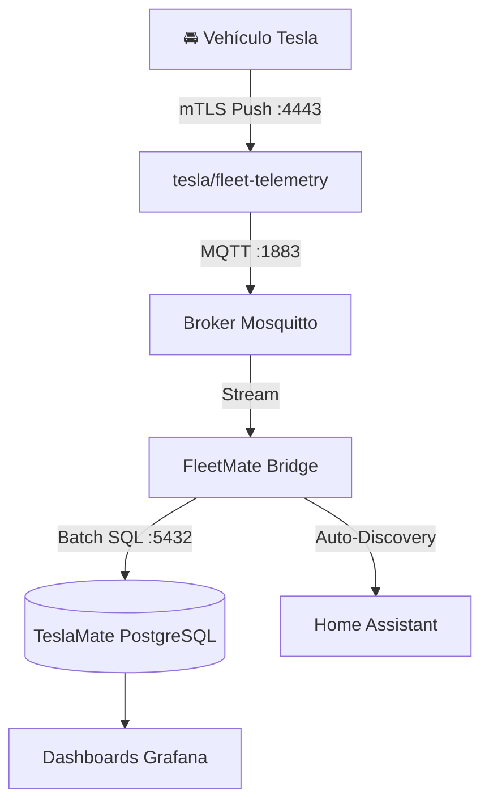

<div align="center">

# 🚘 FleetMate

**Motor de transmisión mTLS y puente de telemetría de alta velocidad a costo $0 para TeslaMate y Home Assistant.**

[](https://github.com/rodolfoconcepcion/fleetmate/actions)
[](https://opensource.org/licenses/MIT)
[](deploy/docker/docker-compose.yml)
[](https://github.com/rodolfoconcepcion/fleetmate/pulls)

[English](README.md) | [Español](README.es.md)

</div>

---

## ⚡ El Problema que FleetMate Resuelve

Desde 2024, los modelos recientes de Tesla (**Model 3 Highland, Cybertruck, nuevos Model Y/S/X**) ya no incluyen el API antiguo de streaming por WebSocket. Los registradores autónomos tradicionales como **TeslaMate** se ven forzados a consultar el API REST oficial (`/api/1/vehicles/{id}/vehicle_data`) cada **2 a 3 segundos** de manera continua mientras conduces.

* **1 hora de manejo:** ~1,200 llamadas REST ($2.40 USD).
* **3 horas de manejo:** ~3,600+ llamadas REST.
* **Resultado:** El crédito gratuito mensual de $10.00 USD de Tesla Developer se agota en un par de días, provocando bloqueos inmediatos por **`403 EXCEEDED_LIMIT`** y cobros sorpresa en tu tarjeta.

## 🚀 La Solución

**FleetMate** se integra directamente con el servidor oficial de código abierto **`fleet-telemetry`** de Tesla. Tu vehículo establece una conexión directa, cifrada y segura por **mTLS (Mutual TLS) WebSocket** desde la carretera hacia tu servidor, transmitiendo datos en vivo a **1 Hz (intervalos de 1 segundo)** a un **costo REST de $0.00**.

FleetMate procesa el flujo de telemetría vía MQTT, detecta dinámicamente los estados de viaje/carga y escribe directamente en la base de datos **PostgreSQL de TeslaMate** y en **Home Assistant**.

---

---

---

## 📦 ¿Qué incluye el Stack? (Todo en 1 Sola Caja)

Una duda muy común es: **"¿Tengo que instalar TeslaMate, PostgreSQL o Grafana por separado en otro servidor?"**

👉 **NO.** Todo viene **100% incluido en el mismo setup automático**. NO necesitas otro servidor, VPS ni instalaciones separadas.

Cuando ejecutas FleetMate, se levanta la suite completa de telemetría de principio a fin en contenedores Docker:

| Contenedor / Servicio | Función en el Stack de FleetMate | ¿Viene incluido? |
| :--- | :--- | :---: |
| **`fleet-telemetry`** | Receptor mTLS oficial de Tesla (:4443) que recibe la data del carro desde la calle. | ✅ **Incluido** |
| **`fleetmate-mosquitto`** | Broker MQTT interno (:1883) que pasa los mensajes en tiempo real. | ✅ **Incluido** |
| **`fleetmate-bridge`** | Nuestro motor de ingesta y máquina de estados de viajes/cargas. | ✅ **Incluido** |
| **`fleetmate-database`** | Base de datos PostgreSQL 16 con el esquema relacional completo de TeslaMate. | ✅ **Incluido** |
| **`fleetmate-grafana`** | Suite oficial de dashboards de Grafana de TeslaMate (:3100) pre-cargada con mapas y métricas. | ✅ **Incluido** |

---

### 🔄 ¿Y si ya tengo una instalación existente de TeslaMate?
Si ya tienes TeslaMate corriendo (por ejemplo en tu Homelab) y solo quieres que FleetMate le inyecte los datos a tu base de datos actual sin levantar otro Postgres ni otro Grafana:
* En tu archivo `.env` o en el Docker Compose, solo indicas la IP de tu base de datos actual:
  ```env
  FLEETMATE_POSTGRES_HOST=192.168.1.100
  FLEETMATE_POSTGRES_PORT=5432
  ```
* FleetMate escribirá directamente en tu TeslaMate existente y tus dashboards de Grafana actuales se actualizarán en vivo.

---

## 🚗 Matriz de Compatibilidad de Vehículos Tesla

FleetMate es compatible con aproximadamente el **95% de todos los vehículos Tesla en circulación**. La compatibilidad depende de la computadora de infoentretenimiento (MCU) y de la versión de software del vehículo:

| Modelo Tesla | Años de Fabricación | Procesador / MCU | ¿Compatible? | Firmware Mínimo Requerido | Notas |
| :--- | :--- | :--- | :---: | :--- | :--- |
| **Model 3** (Todos los modelos y Highland) | 2018 – Presente | Intel Atom / AMD Ryzen (MCU2/3) | ✅ **Sí** | `2024.26+` | Transmisión nativa mTLS a 1 Hz |
| **Model Y** (Todos los modelos) | 2020 – Presente | Intel Atom / AMD Ryzen (MCU2/3) | ✅ **Sí** | `2024.26+` | Transmisión nativa mTLS a 1 Hz |
| **Cybertruck** | 2023 – Presente | AMD Ryzen (MCU3) | ✅ **Sí** | `2024.26+` | Transmisión nativa mTLS a 1 Hz |
| **Model S y Model X** (Refresh) | 2021 – Presente | AMD Ryzen (MCU3) | ✅ **Sí** | `2024.26+` | Transmisión nativa mTLS a 1 Hz |
| **Model S y Model X** (Pre-refresh) | 2018 – 2021 | Intel Atom (MCU2) | ✅ **Sí** | `2025.20+` | Requiere activar en pantalla: *Controles > Seguridad > Permitir transmisión a terceros* |
| **Model S y Model X** (Legacy MCU1) | Antes de Marzo 2018 | NVIDIA Tegra (MCU1) | ❌ **No** | N/A | El hardware viejo de NVIDIA no soporta TLS moderno (Compatible solo si tiene retrofit MCU2) |

## 💻 Requisitos y Opciones de Despliegue

FleetMate está optimizado para ejecutarse tanto en **servidores locales (Homelab / PC / Raspberry Pi)** como en un **Cloud VPS (Servidor en la Nube)**:

### Especificaciones de Hardware
* **Arquitectura:** `x86_64` (AMD64) o `arm64` (AArch64).
* **Entornos Soportados:**
  * **Opción A: Cloud VPS (Recomendado para Uptime 99.99% e IP Pública Fija):** Cualquier VPS económico en **Hetzner (CX22 ~€3.79/mes)**, **DigitalOcean ($4-6/mes)**, **Linode**, **OVH** o **AWS Lightsail**.
  * **Opción B: Servidor Local / Homelab:** Mini PC (Intel NUC), servidor casero, Raspberry Pi 4 / 5 (2 GB RAM mín), o cualquier laptop/PC vieja.
* **Procesador (CPU):** 1 Core mínimo (2 Cores recomendado).
* **Memoria RAM:** 1 GB libre (2 GB recomendado para el stack completo con PostgreSQL y Grafana).
* **Almacenamiento:** 5 GB de espacio libre en disco (SSD o NVMe recomendado para escrituras de base de datos).

### Requisitos de Software
* **Sistema Operativo:** Linux (Ubuntu 22.04/24.04, Debian 12, Fedora, Arch, Raspberry Pi OS), macOS o Windows (WSL2).
* **Docker y Docker Compose:** Docker Engine `v24.0+` y Docker Compose `v2.20+`.
* **Red y Conectividad:**
  * **En un Cloud VPS:** El puerto `4443` está abierto directamente a la IP pública IPv4. Solo apuntas tu dominio DNS (ej. `telemetry.midominio.com`) a la IP del VPS.
  * **En Homelab Local:** Puedes usar un **Cloudflare Zero Trust Tunnel** gratuito (`cloudflared`) sin abrir puertos, o redirigir el puerto `4443` en tu router.
* **Requisitos Previos de Tesla:**
  * Cuenta gratuita de **Tesla Developer** en [developer.tesla.com](https://developer.tesla.com).
  * VIN de tu vehículo y token de acceso al API de Tesla.

---

## 🏗️ Arquitectura del Sistema



---

---

## 🤖 Despliegue Autónomo con Inteligencia Artificial (1 Solo Prompt)

FleetMate está diseñado de forma nativa para la era de la programación agéntica. Si usas herramientas como **Google Antigravity**, **Claude Code**, **Cursor** o **Windsurf**, no tienes que ejecutar comandos ni certificados a mano.

El repositorio incluye un Skill de IA pre-empaquetado: [`.agents/skills/fleetmate-deployer/SKILL.es.md`](.agents/skills/fleetmate-deployer/SKILL.es.md).

**Solo abre el proyecto en tu agente de IA y escribe:**
> *"Instala y configura FleetMate para mi Tesla (VIN: , Token: , Dominio: ). Ejecuta el skill de despliegue y verifica el estado."*

El agente de IA detectará automáticamente tu entorno (VPS o Homelab local), generará los certificados mTLS con SANs válidos, emparejará tu vehículo en la API de Tesla, levantará los contenedores en Docker y comprobará las métricas en Prometheus.

👉 Consulta la [Guía Completa de Despliegue con Agentes de IA](docs/AI_AGENT_SETUP.es.md).

---

## ⚡ Instalación en 1 Sola Línea (Sin Clonar Repositorio)

Ni siquiera necesitas clonar este repositorio ni editar archivos de configuración. Solo copia y pega este comando en cualquier terminal (Linux, VPS o macOS con Docker instalado):

```bash
curl -fsSL https://raw.githubusercontent.com/rodolfoconcepcion/fleetmate/main/install.sh | bash
```

El instalador automático se encarga de todo:
1. Detecta tu tipo de máquina (PC, Raspberry Pi o Cloud VPS).
2. Genera los certificados mTLS con SANs válidos en segundos.
3. Empareja tu Tesla en la API de Tesla con el servidor de telemetría.
4. Descarga las imágenes Docker e inicia todo el stack de transmisión a costo $0.00.

---

## 🛠️ Guía Rápida de Inicio (Listo en 3 Pasos)

### 1. Clona el repositorio
```bash
git clone https://github.com/rodolfoconcepcion/fleetmate.git
cd fleetmate
```

### 2. Ejecuta el asistente interactivo
```bash
./scripts/setup.sh
```
El asistente se encargará de:
- Generar tu Root CA y los certificados de servidor mTLS con nombres alternativos de sujeto (SANs).
- Construir el archivo de configuración para `fleet-telemetry`.
- Emparejar automáticamente tu vehículo mediante el Fleet API de Tesla.

### 3. Inicia los Servicios

* **Para despliegue Local / Homelab:**
  ```bash
  docker compose -f deploy/docker/docker-compose.yml up -d
  ```

* **Para despliegue en un Cloud VPS (puertos blindados, MQTT interno):**
  ```bash
  docker compose -f deploy/vps/docker-compose.yml up -d
  ```

Abre Grafana en `http://TU_IP_O_DOMINIO:3100` y observa cómo tus recorridos se dibujan en tiempo real cada segundo con **cero consumo de API REST**.

---

## 🛡️ Estándares SRE y de Seguridad Empresarial

* **Perfil Blindado para Cloud VPS:** Los servicios internos (MQTT `:1883`, métricas Prometheus `:9090`) escuchan estrictamente en `127.0.0.1` para que solo el puerto `4443` (mTLS seguro del carro) esté expuesto a internet.
* **Seguridad Docker sin Root:** Se ejecuta con un usuario dedicado no privilegiado `UID 10001`.
* **Observabilidad Prometheus:** Métricas de Prometheus nativas en el puerto `9090` (`/metrics`).
* **CI/CD Automatizado:** Pruebas unitarias, análisis estático de seguridad (SAST) con CodeQL, escaneo de vulnerabilidades con Trivy y Dependabot activo.
* **Rama Principal Protegida:** La rama `main` exige pruebas de calidad aprobadas y bloquea force-pushes o eliminaciones accidentales.

---

## 📄 Licencia
Licencia MIT. Desarrollado por [Rodolfo Concepcion](https://github.com/rodolfoconcepcion).
