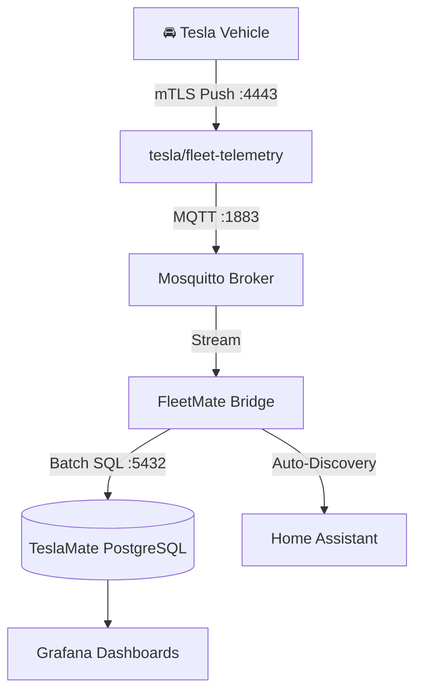

<div align="center">

# 🚘 FleetMate

**High-speed, zero-cost Tesla Fleet Telemetry mTLS streaming engine & bridge for TeslaMate and Home Assistant.**

[](https://github.com/rodolfoconcepcion/fleetmate/actions)
[](https://opensource.org/licenses/MIT)
[](deploy/docker/docker-compose.yml)
[](https://github.com/rodolfoconcepcion/fleetmate/pulls)

</div>

---

## ⚡ The Problem FleetMate Solves

Since 2024, newer Tesla models (**Model 3 Highland, Cybertruck, new Model Y/S/X**) lack the legacy WebSocket streaming API. Traditional self-hosted loggers like **TeslaMate** fall back to polling the official REST API (`/api/1/vehicles/{id}/vehicle_data`) every **2 to 3 seconds** during driving.

* **1 hour of driving:** ~1,200 REST calls ($2.40 USD).
* **3 hours of driving:** ~3,600+ REST calls.
* **Result:** The free $10.00/month Tesla Developer API credit is burned in days, resulting in **`403 EXCEEDED_LIMIT`** lockouts and unexpected bills.

## 🚀 The Solution

**FleetMate** integrates directly with Tesla's official open-source **`fleet-telemetry`** server. Your vehicle establishes a direct, secure **mTLS (Mutual TLS) WebSocket connection** from the road to your self-hosted instance, streaming live data at **1 Hz (1-second intervals)** at **$0.00 REST cost**.

FleetMate consumes the telemetry stream over MQTT, dynamically detects driving/charging states, and writes directly into your existing or turnkey **TeslaMate PostgreSQL database** and **Home Assistant**.

---

## 🏗️ Architecture



---

## 🛠️ Quick Start (Turnkey in 3 Steps)

### 1. Clone the repository
```bash
git clone https://github.com/rodolfoconcepcion/fleetmate.git
cd fleetmate
```

### 2. Run the interactive setup wizard
```bash
./scripts/setup.sh
```
The wizard will:
- Generate your Root CA & mTLS server certificates with Subject Alternative Names (SANs).
- Build the `fleet-telemetry` configuration.
- Automatically pair your vehicle via the Tesla Fleet API.

### 3. Launch the Stack
```bash
docker compose -f deploy/docker/docker-compose.yml up -d
```

Open Grafana at `http://localhost:3100` and watch your drives appear live at 1-second intervals with **zero REST API consumption**.

---

## 🛡️ SRE & Enterprise Standards

* **Zero-Root Docker Security:** Runs with dedicated unprivileged user `UID 10001`.
* **Prometheus Observability:** Native Prometheus metrics on port `9090` (`/metrics`).
* **CI/CD:** Automated testing, CodeQL SAST, Trivy vulnerability scanning, and Dependabot integration.

---

## 📄 License
MIT License. Created by [Rodolfo Concepcion](https://github.com/rodolfoconcepcion).
