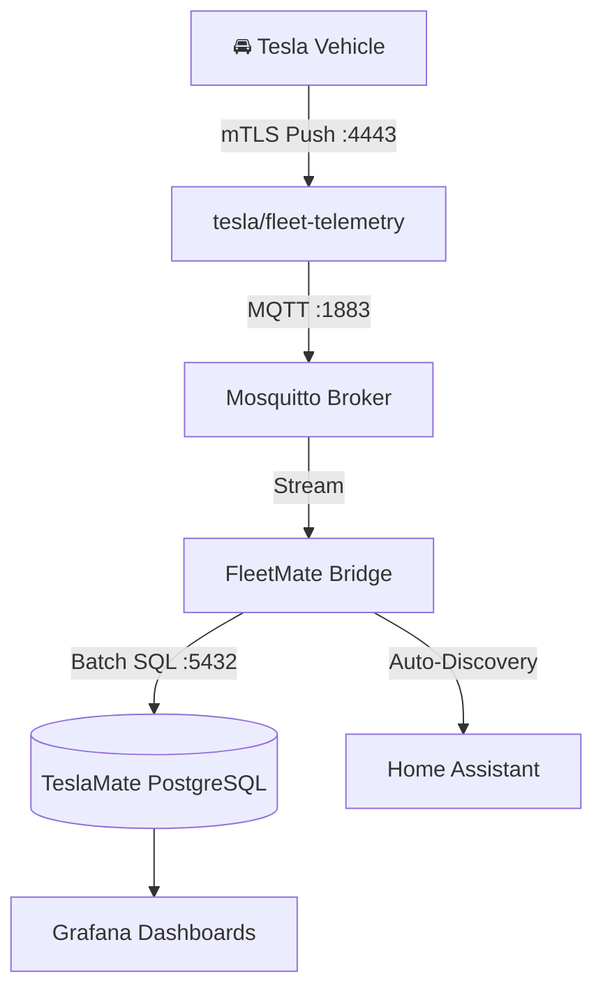

<div align="center">

# 🚘 FleetMate

**High-speed, zero-cost Tesla Fleet Telemetry mTLS streaming engine & bridge for TeslaMate and Home Assistant.**

[](https://github.com/rodolfoconcepcion/fleetmate/actions)
[](https://opensource.org/licenses/MIT)
[](deploy/docker/docker-compose.yml)
[](https://github.com/rodolfoconcepcion/fleetmate/pulls)

[English](README.md) | [Español](README.es.md)

</div>

---

## ⚡ The Problem FleetMate Solves

Since 2024, newer Tesla models (**Model 3 Highland, Cybertruck, new Model Y/S/X**) lack the legacy WebSocket streaming API. Traditional self-hosted loggers like **TeslaMate** fall back to polling the official REST API (`/api/1/vehicles/{id}/vehicle_data`) every **2 to 3 seconds** during driving.

* **1 hour of driving:** ~1,200 REST calls ($2.40 USD).
* **3 hours of driving:** ~3,600+ REST calls.
* **Result:** The free $10.00/month Tesla Developer API credit is burned in days, resulting in **`403 EXCEEDED_LIMIT`** lockouts and unexpected bills.

## 🚀 The Solution

**FleetMate** integrates directly with Tesla's official open-source **`fleet-telemetry`** server. Your vehicle establishes a direct, secure **mTLS (Mutual TLS) WebSocket connection** from the road to your server, streaming live data at **1 Hz (1-second intervals)** at **$0.00 REST cost**.

FleetMate consumes the telemetry stream over MQTT, dynamically detects driving/charging states, and writes directly into your existing or turnkey **TeslaMate PostgreSQL database** and **Home Assistant**.

---

---

---

## 📦 What is Included in the Stack? (Everything in 1 Box)

A common question is: **"Do I need to install TeslaMate, PostgreSQL, or Grafana separately on another server?"**

👉 **NO.** Everything is **100% included in the single automated setup**. You do NOT need another server, VPS, or separate Docker installation.

When you run FleetMate, it spins up the complete end-to-end self-hosted telemetry suite in Docker containers:

| Container / Service | Role in FleetMate Stack | Included in Setup? |
| :--- | :--- | :---: |
| **`fleet-telemetry`** | Tesla's official high-speed mTLS receptor (:4443) receiving vehicle data from the road. | ✅ **Included** |
| **`fleetmate-mosquitto`** | Lightweight internal MQTT broker (:1883) passing real-time messages. | ✅ **Included** |
| **`fleetmate-bridge`** | FleetMate's custom ingestion & trip state machine engine. | ✅ **Included** |
| **`fleetmate-database`** | PostgreSQL 16 database pre-configured with the complete TeslaMate relational schema. | ✅ **Included** |
| **`fleetmate-grafana`** | Official TeslaMate Grafana dashboard suite (:3100) pre-loaded with all drive/charge dashboards. | ✅ **Included** |

---

### 🔄 What if I already have an existing TeslaMate installation?
If you already have TeslaMate running (e.g. in your Homelab) and you just want FleetMate to stream data into your existing database without starting duplicate PostgreSQL or Grafana containers:
* In your `.env` or Docker Compose, simply set your existing PostgreSQL host:
  ```env
  FLEETMATE_POSTGRES_HOST=192.168.1.100
  FLEETMATE_POSTGRES_PORT=5432
  ```
* FleetMate will write directly into your existing TeslaMate database and Grafana will update in real time.

---

## 🚗 Vehicle Compatibility Matrix

FleetMate supports approximately **95% of all Tesla vehicles currently on the road**. Compatibility depends on the vehicle's infotainment computer (MCU) and firmware version:

| Tesla Model | Production Years | Infotainment / MCU | Supported? | Minimum Firmware Required | Notes |
| :--- | :--- | :--- | :---: | :--- | :--- |
| **Model 3** (All trims & Highland) | 2018 – Present | Intel Atom / AMD Ryzen (MCU2/3) | ✅ **Yes** | `2024.26+` | Fully native mTLS streaming |
| **Model Y** (All trims) | 2020 – Present | Intel Atom / AMD Ryzen (MCU2/3) | ✅ **Yes** | `2024.26+` | Fully native mTLS streaming |
| **Cybertruck** | 2023 – Present | AMD Ryzen (MCU3) | ✅ **Yes** | `2024.26+` | Fully native mTLS streaming |
| **Model S & Model X** (Refresh) | 2021 – Present | AMD Ryzen (MCU3) | ✅ **Yes** | `2024.26+` | Fully native mTLS streaming |
| **Model S & Model X** (Pre-refresh) | 2018 – 2021 | Intel Atom (MCU2) | ✅ **Yes** | `2025.20+` | Requires enabling toggle in car UI: *Settings > Safety > Allow Third-Party Streaming* |
| **Model S & Model X** (Legacy MCU1) | Pre-March 2018 | NVIDIA Tegra (MCU1) | ❌ **No** | N/A | Hardware lacks modern TLS crypto stack (Supported only if upgraded to MCU2 retrofit) |

## 💻 System & Deployment Requirements

FleetMate is lightweight, low-footprint, and can be deployed **either locally (Homelab/PC/Raspberry Pi)** or on a **Cloud VPS**:

### Hardware Specifications
* **Architecture:** `x86_64` (AMD64) or `arm64` (AArch64).
* **Supported Environments:**
  * **Option A: Cloud VPS (Recommended for 99.99% Uptime & Static Public IP):** Any affordable VPS from **Hetzner (CX22 ~€3.79/mo)**, **DigitalOcean ($4-6/mo)**, **Linode**, **OVH**, or **AWS Lightsail**.
  * **Option B: Local Homelab / Bare Metal:** Mini PC (Intel NUC), Home Server, Raspberry Pi 4 / 5 (2 GB RAM min), or any spare laptop/desktop PC.
* **CPU:** 1 Core minimum (2 Cores recommended).
* **RAM:** 1 GB free RAM (2 GB recommended for the full stack with PostgreSQL and Grafana).
* **Disk Space:** 5 GB free disk space (NVMe or SSD recommended for PostgreSQL writes).

### Software Requirements
* **Operating System:** Linux (Ubuntu 22.04/24.04, Debian 12, Fedora, Arch, Raspberry Pi OS), macOS (Docker Desktop), or Windows (WSL2).
* **Docker & Docker Compose:** Docker Engine `v24.0+` & Docker Compose `v2.20+`.
* **Network & Ingress:**
  * **On a Cloud VPS:** Port `4443` is directly open to the public IPv4. Just point your domain DNS (e.g. `telemetry.yourdomain.com`) to the VPS IP.
  * **On Local Homelab:** Either route port `4443` via a free **Cloudflare Zero Trust Tunnel** (`cloudflared`) or forward port `4443` on your router.
* **Tesla Prerequisites:**
  * Free **Tesla Developer Account** at [developer.tesla.com](https://developer.tesla.com).
  * Your Vehicle VIN and a Tesla Fleet API access token.

---

## 🏗️ Architecture



---

---

## 🤖 1-Prompt Autonomous AI Setup (Antigravity, Claude Code, Cursor)

FleetMate is built natively for the Agentic Coding era. If you are using **Google Antigravity**, **Claude Code**, or any agentic coding tool, you do not even need to run scripts manually.

FleetMate comes bundled with a native AI Agent Skill: [](.agents/skills/fleetmate-deployer/SKILL.md).

**Just open the repo in your agent and prompt:**
> *"Set up FleetMate for my Tesla (VIN: , Token: , Domain: ). Run the deployer skill and verify health."*

The AI agent will automatically detect your environment (VPS vs Homelab), generate the mTLS certificates, pair your vehicle via the Tesla API, deploy the Docker stack, and verify that telemetry is streaming.

👉 Read the complete [AI Agent Setup Guide](docs/AI_AGENT_SETUP.md).

---

## ⚡ 1-Line Instant Installer (Zero-Clone, Zero-Setup)

You don't even need to clone this repository or write configuration files. Just copy and paste this single command into any terminal (Linux, VPS, or macOS with Docker installed):

```bash
curl -fsSL https://raw.githubusercontent.com/rodolfoconcepcion/fleetmate/main/install.sh | bash
```

The installer automatically:
1. Detects your hardware (PC, Raspberry Pi, or Cloud VPS).
2. Generates complete mTLS SAN certificates.
3. Pairs your Tesla vehicle with Fleet Telemetry via Tesla Fleet API.
4. Pulls the official Docker images and starts the full streaming stack.

---

### 🔍 Smart Auto-Discovery Engine (Existing TeslaMate & Homelab Detection)
If you already run **TeslaMate**, an existing **PostgreSQL** database, or a **Mosquitto MQTT** broker on your machine or Homelab:
* The installer **automatically scans Docker** for running instances (e.g. `runtipi-teslamate-db`, `teslamate_database`, `mosquitto`).
* It prompts: `💡 Auto-Discovery Insight: Attach to existing TeslaMate installation? [Y/n]`.
* If confirmed, FleetMate automatically selects the **Hybrid Profile** (`docker-compose.hybrid.yml`), resolves internal Docker bridge IPs, and streams telemetry directly into your existing database.
* **Zero duplication:** It does NOT start unnecessary secondary PostgreSQL or Grafana containers.

---

## 🛠️ Quick Start (Turnkey in 3 Steps)

### 1. Clone the repository
```bash
git clone https://github.com/rodolfoconcepcion/fleetmate.git
cd fleetmate
```

### 2. Run the interactive setup wizard
```bash
./scripts/setup.sh
```
The wizard will:
- Generate your Root CA & mTLS server certificates with Subject Alternative Names (SANs).
- Build the `fleet-telemetry` configuration.
- Automatically pair your vehicle via the Tesla Fleet API.

### 3. Launch the Stack

* **For Local / Homelab deployment:**
  ```bash
  docker compose -f deploy/docker/docker-compose.yml up -d
  ```

* **For Cloud VPS deployment (hardened ports, internal MQTT):**
  ```bash
  docker compose -f deploy/vps/docker-compose.yml up -d
  ```

Open Grafana at `http://YOUR_SERVER_IP:3100` and watch your drives appear live at 1-second intervals with **zero REST API consumption**.

---

## 🛡️ SRE & Enterprise Standards

* **Hardened Cloud VPS Profile:** Internal services (MQTT `:1883`, Prometheus `:9090`) bind strictly to `127.0.0.1` so only port `4443` (mTLS) is publicly accessible.
* **Zero-Root Docker Security:** Runs with dedicated unprivileged user `UID 10001`.
* **Prometheus Observability:** Native Prometheus metrics on port `9090` (`/metrics`).
* **CI/CD:** Automated testing, CodeQL SAST, Trivy vulnerability scanning, and Dependabot integration.
* **Protected Branch:** Main branch enforces status checks (`lint-and-test`, `security-scan`) and prevents accidental force-pushes or deletions.

---

## 📄 License
MIT License. Created by [Rodolfo Concepcion](https://github.com/rodolfoconcepcion).
